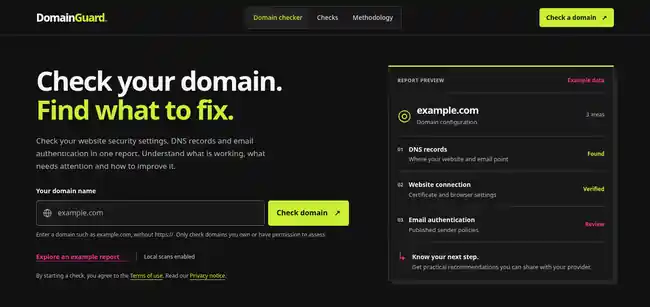

<p align="center">
  
</p>

### The project

I started DomainGuard as a Python command-line tool to make it easier to check a domain's configuration. It has since grown into a local web application that helps website owners understand the settings behind their websites and email services without needing to know how DNS or security protocols work.

Enter a domain name and DomainGuard collects public configuration information, explains what it finds and suggests practical next steps. The results are available through a browser or the command line.

<p align="center">
  
</p>

<sub>Local interface with illustrative example data.</sub>

### What it does

| Area | What DomainGuard checks |
| --- | --- |
| DNS | Where a website and its email services are directed, including published DNS records. |
| Website connection | Whether a verified HTTPS connection can be established and how the root page responds. |
| Certificates | Whether the TLS certificate matches the domain and when it expires. |
| Browser protection | Published security headers that help browsers protect visitors. |
| Email security | Published SPF, DMARC, MTA-STS and SMTP TLS reporting records. |

Reports explain findings in plain language, with technical evidence available when needed. Users can download a JSON report or a printable action plan that explains what to review, who can help and how to verify changes.

### How it's built

The assessment engine, command-line interface and local API are written in **Python**. The responsive website uses **HTML, CSS and JavaScript**, with no frontend framework or external runtime font service.

The application validates domain input, screens resolved network addresses, verifies TLS connections and runs scans in bounded worker processes. Reports use private access credentials and expire after 15 minutes. The hosted DNS mode uses Google's public DNS-over-HTTPS service from the visitor's browser. The full Python assessment engine remains local-only.

### How it's progressed

The original CLI had 56 passing Python tests. V2 adds a web interface, expanded configuration checks, structured reports, action plans and adversarial security tests.

| Python tests | JavaScript tests | Python coverage |
| :---: | :---: | :---: |
| **317 passed** | **18 passed** | **92%** |

<sub>Windows validation, November 27, 2026. Two Linux-specific tests skipped; coverage is rounded combined statement and branch coverage. Bandit (medium/high), Gitleaks and dependency audits reported no findings at the time of testing.</sub>

### Get started

Requires Python 3.12 or newer. From the repository root, create and activate a virtual environment, then run:

```sh
python -m pip install .
python -m domain_guard.web_api
```

Open `http://127.0.0.1:8000/` to explore the example report. The [user guide](docs/usage.md) explains installation, CLI usage and enabling authorized local scans.

### Repository guide

| File or directory | Purpose |
| --- | --- |
| [`domain_guard/`](domain_guard/) | Assessment engine, local API, web interface and report generation. |
| [`tests/`](tests/) | Automated Python and JavaScript tests. |
| [`scripts/`](scripts/) | Local verification and font installation tools. |
| [`docs/`](docs/) | Usage instructions, development documentation and README graphics. |
| [`main.py`](main.py) | Command-line entry point. |
| [`requirements.txt`](requirements.txt) | Python libraries needed to run DomainGuard. |
| [`requirements-dev.txt`](requirements-dev.txt) | Additional testing, coverage and security analysis libraries. |
| [`pyproject.toml`](pyproject.toml) | Python package metadata, installation settings and entry points. |
| [`SECURITY.md`](SECURITY.md) | Supported operation and responsible vulnerability reporting. |
| [`.gitignore`](.gitignore) and [`.gitattributes`](.gitattributes) | Repository housekeeping and consistent file formatting. |

### Documentation and responsible use

**[Hosted DNS mode](docs/hosted.md)** · **[User guide](docs/usage.md)** · **[Development and testing](docs/development.md)** · **[Security policy](SECURITY.md)**

[Privacy notice](domain_guard/static/privacy.html) · [Terms of use](domain_guard/static/terms.html)

DomainGuard provides configuration observations, not a penetration test or security certification. Only assess domains you own or have permission to check. The hosted site supports live DNS and email observations only. Full public HTTPS, TLS and header assessment requires separate infrastructure and security verification.

---

Developed by [Tarun Puri](https://github.com/PuriiTarun).
